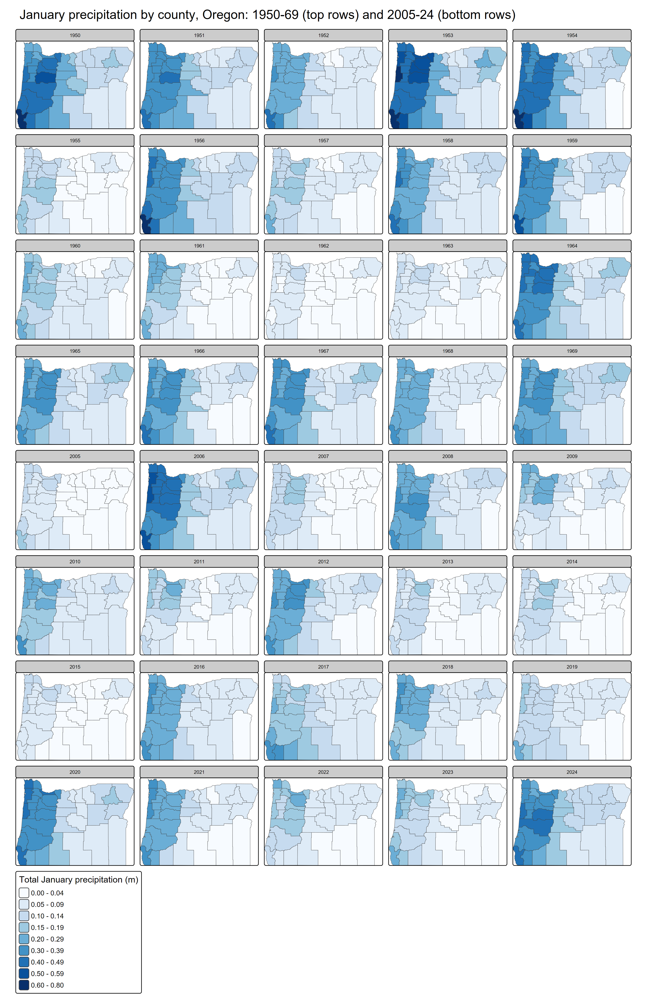

```{r setup, include=FALSE}
knitr::opts_chunk$set(echo = TRUE, message = FALSE, warning = FALSE)
library(tidyverse)
library(knitr)
library(sf)
library(tmap)
```

## Confidence intervals

**Your name: Shima Khodagholi**

**Overview:**

In this lab, we will create confidence intervals for January precipitation in Washington during two time periods: 1950-1969 and 2005-2024. Using county-level precipitation data from the ERA5 dataset, you will estimate statewide precipitation patterns, then examine variation and change at the county level. We've summed the precipitation in January for each county over two twenty year time periods: 1950-1969 and 2005-2024. You'll be using those data to create confidence intervals at a state and county level.

To load these data, load the csv file, which is included in the data folder:

```{r message=FALSE}
era5_data<-read_csv("data/precip_uswest_era5.csv")
```

This is a long format dataset including county identifiers, county population, median household income, and poverty rate. Census figures are based on the 2018-22 ACS. The last two columns (year, prcp_m, time_range) give the year and total precipitation in meters from the ERA5 NetCDF file, and two time ranges (1950-1969 and 2005-2024).

The script used to create this dataframe is also provided in this repository ('lab3_dataprep'), along with rasters of the yearly mean total precipitation for Januaries in the two time periods of interest.

For this lab to be marked complete, it must demonstrate the following learning standards:

* 11. Create effective data visualizations across multiple chart types (line, scatter, histogram, Q-Q plot), applying appropriate aesthetic choices such as color, grouping, and labeling. (Tasks 2 and 5)
* 12. Produce and interpret confidence interval plots that enable visual comparison of means and uncertainty across groups or time periods. (Tasks 2, 3, 5, and 6)
* 13. Visualize spatial data using appropriate mapping tools, selecting suitable classification schemes and cartographic elements to support clear communication. (Task 7)
* 14. Arrange and present tabular results in a readable format appropriate for a technical document or report. (Tasks 1 and 4)
* 15. Use measures of central tendency and dispersion to describe the variables in tabular datasets (Tasks 1 and 4)
* 20. Explaining how evidence from a sample supports conclusions about a population while acknowledging sampling variability and uncertainty. (Tasks 3 and 6)
* 22. Construct and interpret confidence intervals, explaining how factors such as sample size and spatial scale affect the precision of an estimate. (Tasks 1, 3, 4 and 6)


# Part 1: Calculating statewide confidence intervals for Washington's precipitation

In the first part of this lab, you'll determine a confidence interval for Washington's precipitation for these two time periods. This can be helpful in identifying whether precipitation has changed across the state (e.g., whether the two confidence intervals overlap) using the county data as your sample.

**Task 1** _Load the data and filter it to just include data for the state of Washington. Then create a table showing mean precipitation, standard deviation, number of observations (sample size), and upper/lower confidence interval bounds for each of the two time periods in the `time_range` field. Use `kable` to display the table when you are done._

```{r Task1}
era5_washington <- era5_data %>%
  group_by(time_range) %>%
  filter(st_name=="Washington") %>%
  summarise(prcp_mean = mean(prcp_m),
            prcp_sd = sd(prcp_m),
            observations = n(),
            se = prcp_sd/sqrt(observations),
            error = qnorm(0.975)*se,
            ci_high=prcp_mean+error,
            ci_low=prcp_mean-error
            )

kable(era5_washington)
```

Using the code provided in class, create a ggplot graphic that visualizes these two confidence intervals. You'll want to use `geom_point` and `geom_linerange` to do so. Use states as the y-axis and mean precipitation as the x axis. Vary the color and position of the dots and lines for the mean/CI by the `time_range` variable. Feel free to also experiment with axis labels/themes to make the graph more appealing and accessible.

**Task 2** _Create a ggplot graphic as described above to show the confidence intervals for precipitation in Washington for each time range._

```{r Task2}
ggplot(era5_washington, aes(y = time_range, color = time_range))+
  geom_linerange(aes(xmin=ci_low,xmax=ci_high,y=time_range,group=time_range), linewidth = 1) +
  geom_point(aes(x=prcp_mean,y=time_range), size = 3)+
  labs(x = "Mean January precipitation (m)",
       y = "Time period",
       color = "Time period",
       title = "95% confidence intervals for January precipitation in Washington") +
  theme_minimal()+
  theme(legend.position = "none")
```

**Task 3** _Interpret your table and graph. What do they tell us about the change in Washington's precipitation during this time?_

> Based on the table, mean January precipitation in Washington was about 0.203 m in 1950–1969 and decreased to about 0.166 m in 2005–2024. The 95% confidence interval for 1950–1969 is (0.192, 0.214), while the interval for 2005–2024 is (0.158, 0.175). The intervals do not overlap, and the gap between them is wide relative to their widths. This is strong evidence that average January precipitation was lower in the recent period and that the difference is not just the result of random sampling variation. The standard deviation also fell, from 0.156 to 0.123, which suggests that precipitation varied less across counties and years in the recent period. This lower variability is also why the confidence interval for 2005–2024 is narrower, even though both periods have the same sample size (n = 780).


# Part 2: Analyzing county data in Washington.
In part 1, you ran a state level analysis. What if you wanted to identify where populations might be negatively affected by precipitation changes within a state? In this section, you'll look at the changes in precipitation **at county level** in Washington to 

To start with, adapt your code from step 1 so that you create confidence intervals for **counties** instead of states. After creating that dataset, create another ggplot graph of those confidence intervals that you can compare to the state level data in Task 2 to examine how precipitation has changed across counties in Washington.

**Task 4** _Create a summary table for January precipitation in Washington counties for both time periods. Use the same approach as in Task 1, but calculate statistics for counties rather than the state as a whole. Call the head of your table with `kable` when you are done._

```{r Task4}
era5_wa_counties <- era5_data %>%
  group_by(cty_name,time_range) %>%
  filter(st_name=="Washington") %>%
  summarise(prcp_mean = mean(prcp_m),
            prcp_sd = sd(prcp_m),
            observations = n(),
            se = prcp_sd/sqrt(observations),
            error = qnorm(0.975)*se,
            ci_high=prcp_mean+error,
            ci_low=prcp_mean-error
            )

kable(head(era5_wa_counties))
```

**Task 5** _Visualize the confidence intervals for the county-level data you generated in task 4, using the same style as you did for Task 2 above. For an optional extra challenge, visually highlight the counties where the confidence intervals between time periods do NOT overlap._

```{r Task5, fig.height=10, fig.width=8}
ggplot(era5_wa_counties %>%
         mutate(cty_name = str_remove(cty_name, " County, Washington")),
       aes(x = reorder(cty_name, prcp_mean), y = prcp_mean, color = time_range)) +
  geom_linerange(aes(ymin = ci_low, ymax = ci_high),
                 position = position_dodge(width = 0.6), linewidth = 1) +
  geom_point(position = position_dodge(width = 0.6), size = 2) +
  coord_flip() +
  labs(x = "County",
       y = "Mean January precipitation (m)",
       color = "Time period",
       title = "95% confidence intervals for January precipitation by county, Washington") +
  theme_minimal()
```
> By looking at the plot, we can see that all counties have CI overlaps for two year periods. Here is a code to check the overlaps precisely:

```{r}
overlap <- era5_wa_counties %>%
  select(cty_name, time_range, ci_low, ci_high) %>%
  pivot_wider(names_from = time_range, values_from = c(ci_low, ci_high)) %>%
  mutate(no_overlap = `ci_low_1950-69` > `ci_high_2005-24` |
                      `ci_high_1950-69` < `ci_low_2005-24`) %>%
  select(cty_name, no_overlap)

kable(overlap)
```


**Task 6**: _Compare the size of the error terms for your county level data to the error terms at state level that you calculated in Task 1. Are they bigger or smaller? Explain why the formula you used for calculating the error terms produced error terms of different sizes. How is this difference visible in your ggplot graphs?_

> The error terms are much larger at the county level than at the state level for most counties. This comes from the formula for the error term, which divides the standard deviation by the square root of the number of observations. When the number of observations decreases, the error term increases. In this dataset, we moved from 780 observations at the state level to only 20 observations per county. The standard deviation also plays a role. The statewide SD includes the large differences between counties, while each county’s SD reflects only the year-to-year variation within that county. This is why some very dry eastern counties have small error terms despite their small sample size. These differences are visible in the graphs. In Task 2, the two statewide intervals are short and clearly separated. In Task 5, most county intervals are much longer, and the two periods overlap in every county, even though nearly every county’s 2005–2024 mean is lower. The intervals also get wider from the bottom of the plot (the drier counties) to the top (the wetter counties), because the wetter counties vary more from year to year.


```{r}
kable(era5_wa_counties %>%
  group_by(time_range) %>%
  summarise(min_error = min(error),
            median_error = median(error),
            max_error = max(error)))

```


**Task 7**: _Transform the county data from task 4 into wide format so that the means for each time period are in the same row for each county. Then calculate the change in precipitation between the time periods. Join this table to the geopackage file that contains county boundaries and census data, making sure that you only have Washington counties included - use the geopackage `data/acsdata_cty_westreg.gpkg`. Then use `tmap` to map out the difference in precipitation means across the two time periods. Make sure the legend of this map is interpretable._

```{r Task7}

cty_boundaries <- st_read("data/acsdata_cty_westreg.gpkg", quiet= TRUE)

era5_wa_counties_wide <- era5_wa_counties %>%
  pivot_wider(names_from = time_range,
              values_from = !c(cty_name, time_range)) %>%
  mutate(prcp_change = `prcp_mean_2005-24` - `prcp_mean_1950-69`)

wa_map_data <- cty_boundaries %>%
  inner_join(era5_wa_counties_wide, by = "cty_name")

tm_shape(wa_map_data) +
  tm_polygons(fill = "prcp_change",
              fill.scale = tm_scale_intervals(values = "brewer.br_bg", midpoint = 0),
              fill.legend = tm_legend(title = "Change in mean\nJanuary precipitation (m)\n2005-24 minus 1950-69")) +
  tm_title("Change in January precipitation, Washington counties")
```


# Optional challenge section: Interpreting the implications of precipitation changes

Now that you've calculated these means and confidence intervals, let's identify who might be most affected by changes in precipitation. To see who is affected, create a dummy variable that flags any counties with a decline of 5 centimeters or more (0.05 meters) with a 1, labeling all other counties with a 0. Use group_by and summarise to do the following:

* Count the total population in each of these two county groups.
* Calculate the mean value for median income and poverty rate in these two groups.

**Task 8** _Create a dummy variable for counties with a change of 0.05 meters or more between the time periods. Calculate how many people currently live in these counties along with the mean value of median income (medinc) and poverty rate (pov_pop_pct) for those areas._

```{r Task8}
wa_affected <- wa_map_data %>%
  st_drop_geometry() %>% 
  mutate(decline_5cm = if_else(prcp_change <= -0.05, 1, 0)) %>%
  group_by(decline_5cm) %>%
  summarise(counties = n(),
            total_pop = sum(totpop_race),
            mean_medinc = mean(medinc),
            mean_pov_pct = mean(pov_pop_pct))

kable(wa_affected, digits = 2,
      col.names = c("Decline of 5 cm or more", "Counties", "Total population",
                    "Mean median income ($)", "Mean poverty rate"))

wa_map_data <- wa_map_data %>%
  mutate(decline_5cm = if_else(prcp_change <= -0.05,
                               "Decline of 5 cm or more",
                               "Decline of less than 5 cm"))

tm_shape(wa_map_data) +
  tm_polygons(fill = "decline_5cm",
              fill.scale = tm_scale_categorical(values = c("Decline of 5 cm or more" = "darkorange",
                                                           "Decline of less than 5 cm" = "yellow")),
              fill.legend = tm_legend(title = "Change in mean January\nprecipitation, 1950-69 to 2005-24")) +
  tm_title("Washington counties with a January precipitation decline of 5 cm or more")
```

**Task 9** _Create a one paragraph summary of your results from tasks 7 and 8. What do you learn about how precipitation has changed in the last 70 years across the state of Washington? How would you describe the population affected by large drops in precipitation based on your results?_

> Comparing January precipitation in 1950–69 and 2005–24 shows that nearly every county in Washington became drier, but the size of the decline varied strongly by region. The map of change in mean precipitation shows the largest declines in western Washington, where the wettest counties lost the most precipitation, while the drier counties east of the Cascades changed much less in absolute terms. Fifteen counties, all in western Washington, had a decline of 5 cm or more. These counties are home to about 3.37 million people, roughly 44% of the state’s population. The counties with large declines were not poorer than the rest of the state: their mean median household income was somewhat higher ($76,272 vs. $70,041) and their mean poverty rate somewhat lower (11.4% vs. 13.0%). These comparisons have limits. Comparing two 20-year periods shows a difference between them rather than a steady long-term trend, since natural climate cycles can make one period wetter than another.


Small multiples or multi-panel maps are often a helpful way to show change over time. See this page for more information about how these are created in `tmap`:

* https://r-tmap.github.io/tmap/articles/basics_facets

Using these tools, create a small multiples map of your precipitation data for counties in a state of your choice for all 40 years in these two time periods. This means you will have one figure with 40 individual maps, all of the same state in different years. These maps should allow easy comparison across years and should be clearly labeled so that they could be interpreted by someone with no knowledge of this assignment. 

In addition, describe two interesting trends you see in the figure you created.

```{r challenge, dpi=300}

era5_or_yearly <- era5_data %>%
  filter(st_name == "Oregon") %>%
  mutate(year = as.integer(format(as.Date(year), "%Y"))) %>%
  select(cty_name, year, prcp_m)

or_yearly_map <- cty_boundaries %>%
  inner_join(era5_or_yearly, by = "cty_name")

or_facets <- tm_shape(or_yearly_map) +
  tm_polygons(fill = "prcp_m",
              fill.scale = tm_scale_intervals(
                breaks = c(0, 0.05, 0.1, 0.15, 0.2, 0.3, 0.4, 0.5, 0.6, 0.8),
                values = "brewer.blues"),
              fill.legend = tm_legend(title = "Total January precipitation (m)"),
              col = NA) +
  tm_facets_wrap(by = "year", ncol = 5) +
  tm_title("January precipitation by county, Oregon: 1950-69 (top rows) and 2005-24 (bottom rows)") +
  tm_layout(outer.margins = 0, inner.margins = 0,
            panel.label.size = 0.8,
            legend.outside = TRUE, legend.outside.position = "bottom")

tmap_save(or_facets, "or_precip_facets.png", width = 11, height = 17, dpi = 300)



```

> The small multiples map of January precipitation in Oregon’s counties shows two clear trends. First, the west–east contrast holds in every year: the western parts are always the wettest areas, while southeastern Oregon stays among the driest. Even in the wettest Januaries it rarely receives more than about 0.2 m. Second, the recent period appears drier overall. In 1950–69, several years (such as 1950, 1953, 1954 and 1956) reach the highest precipitation classes, while in 2005–24 only 2006 clearly reaches that level, and very dry Januaries such as 2005, 2013, 2014, 2015 and 2019 seem more common. The maps also show that wet and dry years tend to affect the whole state at once, and that the variation from one year to the next is much larger than the difference between the two periods. This helps explain why county-level confidence intervals based on only 20 years were so wide.


# Final submission stuff

**Disclosure of assistance:** Besides class materials, what other sources of assistance did you use while completing this lab? These can include input from classmates, relevant material identified through web searches (e.g., Stack Overflow), or assistance from ChatGPT or other AI tools. How did these sources support your own learning in completing this lab?

> I used web searches and Claude for the challenge section. I had trouble getting the facets to work and kept getting the error `Error: Margins are too large, or too many facets.` Claude helped me troubleshoot the code and suggested saving the plot as an image and then displaying it in the document. I used the tool for guidance only, and I wrote the final code myself.

**Lab reflection:** How do you feel about the work you did on this lab? Was it easy, moderate, or hard? What are the biggest things you learned by completing it?

> The difficulty of this lab varied between the main tasks and the challenge task. The main tasks felt easy to moderate to me: they didn’t require complicated code, just a good understanding of the statistics. The challenge task was harder because I had to work out the right code to produce the results I wanted, and I ran into several problems along the way. I hadn’t worked with facets before, and R gave the error “Margins are too large, or too many facets” because 40 maps didn’t fit in the plot window. I solved this by saving the map as a large image with tmap_save() and then displaying the saved file. Once the map rendered, all 40 panels looked identical, and the panel labels showed numbers like -7305 and 19723 instead of years. It turned out the year column was stored as a date, which R counts in days since 1970, so the facets were neither labeled nor separated correctly. Converting the dates to plain year numbers fixed both problems. Finally, I added finer color breaks so that the differences between years were easier to see. As I mentioned above, I used Claude to help me troubleshoot these issues, and working through them taught me to check how variables are stored before mapping them.
